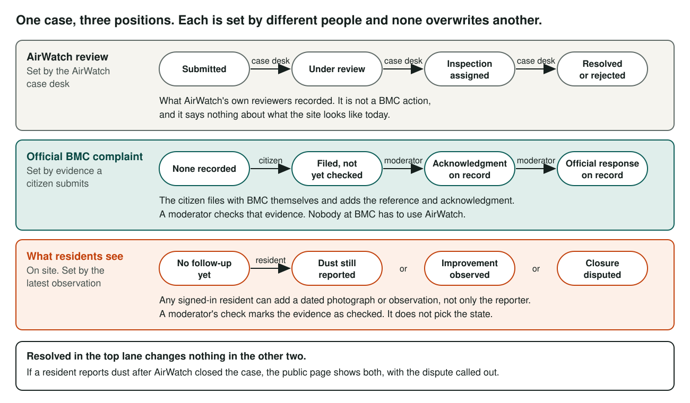
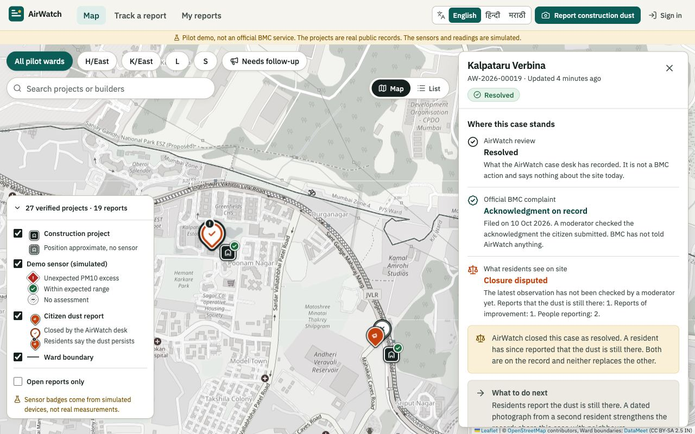
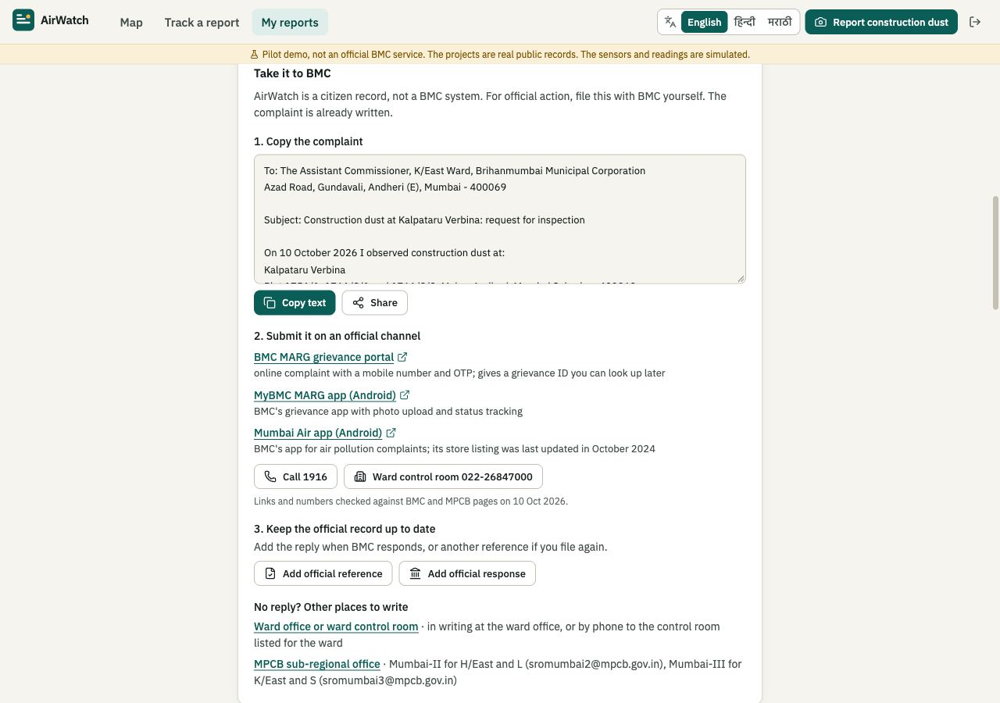
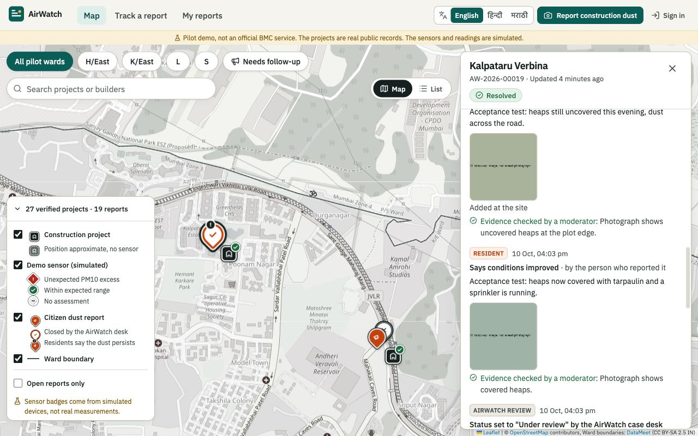
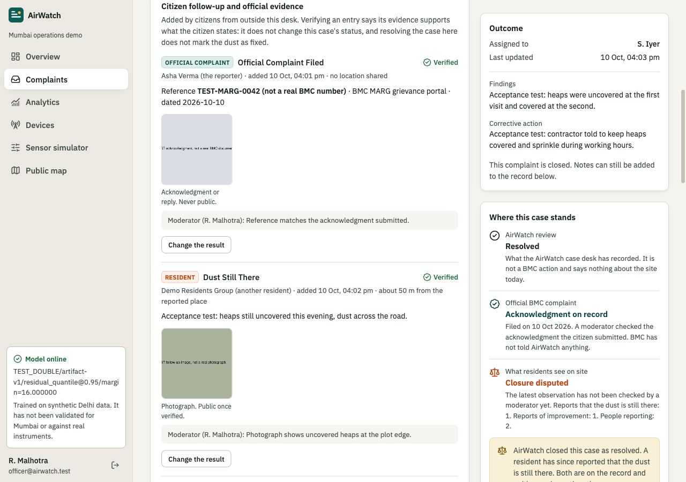
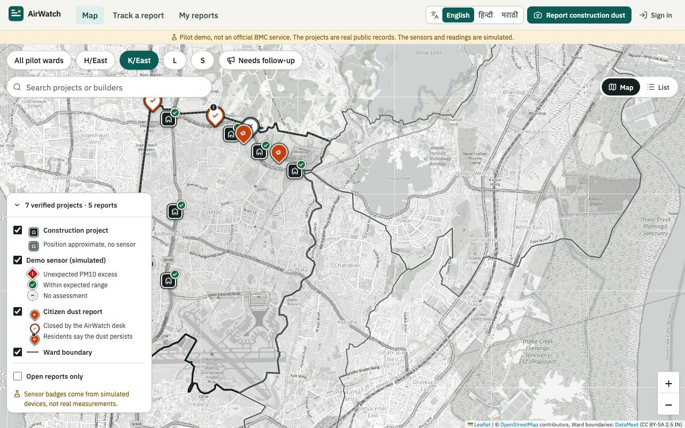
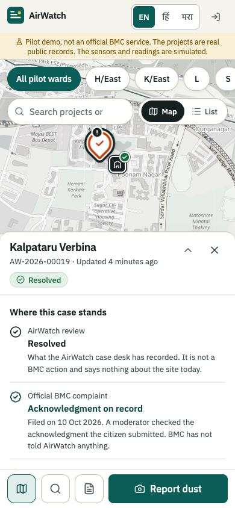

# Independent accountability

A status on AirWatch used to mean one thing: what someone typed into the AirWatch case desk. That
shows a workflow. It does not show that BMC did anything, or that the dust stopped.

This part of the product lets a citizen carry a case to BMC themselves, bring the proof back, and
record what the site looks like afterwards. It works with nobody at BMC using AirWatch.

## Three positions, never merged

| Position | Who sets it | What it can say |
| --- | --- | --- |
| AirWatch review | The AirWatch case desk | Submitted, Under review, Inspection assigned, Resolved, Rejected |
| Official BMC complaint | Evidence a citizen submits, checked by a moderator | None recorded, Filed and not yet checked, Acknowledgment on record, Official response on record |
| What residents see on site | The latest observation from any resident | No follow-up yet, Dust still reported, Improvement observed, Closure disputed |

Rules that hold everywhere, in the API and on every screen:

- Resolving a case on the AirWatch desk does not mark the dust as fixed. It changes the first
  position only.
- The official position moves past "Filed, not yet checked" only when a moderator has checked the
  acknowledgment or reply the citizen submitted. "On record" means the citizen's copy was checked.
  It never means BMC confirmed anything to AirWatch.
- If a resident reports dust after AirWatch closed a case as resolved, the public page shows both
  and says so. Neither replaces the other.
- A follow-up a moderator set aside counts for nothing, and stays in the trail with the reason.

## The loop a citizen follows

1. **Find the site and report dust.** The report gets a case link, `/report/AW-...`, that anyone can
   open without signing in.
2. **Take it to BMC.** The case page has the complaint already written (place, project record,
   ward office, the BMC guideline points, the case link), a copy button, and the official channels
   with the pages they were checked against. Nothing has to be looked up.
3. **Record the reference.** After filing, the citizen adds the complaint number, the date, the
   channel and a screenshot of the acknowledgment. The number is public so others can quote it. The
   screenshot is seen by moderators only.
4. **Follow up.** Anyone signed in can add **Still unresolved**, **Improvement observed**, a
   **follow-up note**, or, on a closed case, **Dispute closure**, with photographs and, if they
   choose, their location. A neighbour or a residents' group can do this for the reporter.
5. **A moderator checks the evidence.** Until then an entry shows as "not yet checked" and its
   text and photographs are withheld.
6. **Share.** WhatsApp, the phone's share sheet, or the link. The message carries all three
   positions.

The case page also says what to do next. With nothing filed: file it. Filed with no response
recorded for seven days: quote the reference on 1916, add a fresh photograph, write to the MPCB
sub-regional office. Residents still reporting dust: get a second resident's photograph.

## What is protected

- A follow-up's author is shown only as "the person who reported it" or "another resident".
- Every uploaded image has its embedded metadata removed before it is stored: EXIF with its GPS
  position, XMP, IPTC, comments. Only the orientation is kept.
- A citizen's location is never shown. The public sees the distance from the reported place,
  rounded to 50 m.
- An acknowledgment or reply document is never public.
- Public photographs are not cached by browsers: hiding a report or setting a follow-up aside stops
  them being served at once.

## For the case desk

The case file has a section for citizen follow-up with each entry's evidence, who added it and how
far from the site they stood. A moderator marks an entry **Evidence supports it** or **Set aside**
(with a reason). That check is written to the audit trail. It does not move the case status, and
the lifecycle rules are unchanged.

The inbox filters by **Evidence to check** and **Closure disputed**. If BMC later uses this desk,
the same case and the same trail are what its officers would see.

## Outcomes that are counted

`GET /api/public/overview` returns `outcomes` for the pilot and per ward: reports filed, cases a
citizen took to BMC, checked acknowledgments, official responses on record, cases where residents
confirmed improvement, cases where residents say the dust persists or dispute a closure. The list
view shows them. No budget or spending figures are shown: nothing connects a civic spending line
to dust control at one private site.

## Map markers

Every map in the app uses one set of shapes, so nothing depends on telling two colours apart.

| Shape | Meaning |
| --- | --- |
| Dark square | A construction project from public records. A dashed edge means its position is approximate |
| Badge on the square | The DEMO sensor there: a diamond is a PM10 flag, a disc is within range, a hatched disc is no assessment |
| Pin | A citizen dust report: filled is open, hollow is closed by the AirWatch desk, a corner mark means residents say the dust persists |
| Thin grey line | A ward boundary. Pilot wards are solid, the others dotted |

Markers are 44 px tap targets, focusable, named for screen readers, and open with Enter or Space.
The legend doubles as the layer switches.

## API

| Endpoint | Who | Does |
| --- | --- | --- |
| `POST /api/complaints/reports/:reference/follow-ups` | Any citizen | Adds a follow-up. Multipart: `kind`, `note`, `occurredOn`, `latitude`, `longitude`, `officialChannel`, `officialReference`, `photos` (up to 4), `acknowledgment` (1) |
| `POST /api/municipal/follow-ups/:id/check` | Case desk | `{ check: "VERIFIED" or "SET_ASIDE", note }` |
| `GET /api/public/reports/:reference` | Anyone | The case with `positions` and `followUps` |
| `GET /api/municipal/complaints?followUp=unchecked` or `disputed` | Case desk | The two queues |

`kind` is one of `OFFICIAL_COMPLAINT`, `OFFICIAL_RESPONSE`, `STILL_UNRESOLVED`,
`IMPROVEMENT_OBSERVED`, `DISPUTE_CLOSURE`, `NOTE`. Follow-ups live in the `FollowUp` table, their
files in `Attachment`, and each add and each check writes a `ComplaintEvent`.
